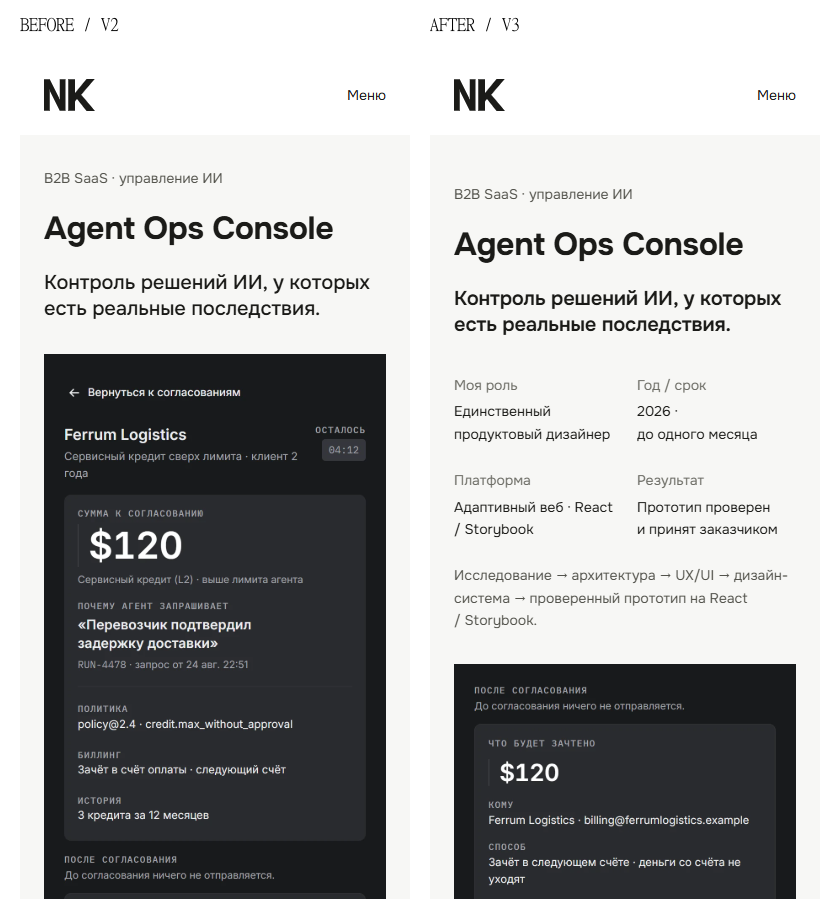

# RU · 390px

Matched Chromium captures, same source baseline and final implementation.

| Before · complete page | After · complete page |
|---|---|
|  |  |

- problem: [before](../before/ru-390-problem.webp) / [after](../after/ru-390-problem.webp)
- operating-model: [before](../before/ru-390-operating-model.webp) / [after](../after/ru-390-operating-model.webp)
- investigation: [before](../before/ru-390-investigation.webp) / [after](../after/ru-390-investigation.webp)
- checkpoint: [before](../before/ru-390-checkpoint.webp) / [after](../after/ru-390-checkpoint.webp)
- policy: [before](../before/ru-390-policy.webp) / [after](../after/ru-390-policy.webp)
- autonomy: [before](../before/ru-390-autonomy.webp) / [after](../after/ru-390-autonomy.webp)
- outcome: [before](../before/ru-390-outcome.webp) / [after](../after/ru-390-outcome.webp)
