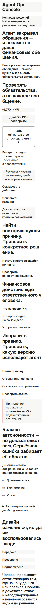
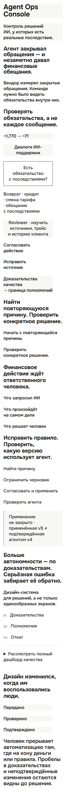

# RU · 320 px

Matched Chromium production captures, reduced motion, device scale 1. Before: eb7b9e7. After: V3.1. Height 800px.

| Surface | Before | After |
|---|---|---|
| First viewport | [Before](../before/ru-320-viewport.webp) | [After](../after/ru-320-viewport.webp) |
| Full page | [Before](../before/ru-320-full.png) | [After](../after/ru-320-full.png) |
| All 37 headings | [Before](../before/ru-320-headings.webp) | [After](../after/ru-320-headings.webp) |
| Next-case title | [Before](../before/ru-320-next.webp) | [After](../after/ru-320-next.webp) |
| problem | [Before](../before/ru-320-problem.webp) | [After](../after/ru-320-problem.webp) |
| operating-model | [Before](../before/ru-320-operating-model.webp) | [After](../after/ru-320-operating-model.webp) |
| investigation | [Before](../before/ru-320-investigation.webp) | [After](../after/ru-320-investigation.webp) |
| checkpoint | [Before](../before/ru-320-checkpoint.webp) | [After](../after/ru-320-checkpoint.webp) |
| policy | [Before](../before/ru-320-policy.webp) | [After](../after/ru-320-policy.webp) |
| autonomy | [Before](../before/ru-320-autonomy.webp) | [After](../after/ru-320-autonomy.webp) |
| outcome | [Before](../before/ru-320-outcome.webp) | [After](../after/ru-320-outcome.webp) |

Before / After heading sheets below are unscaled browser crops, separated into rows in document order. Full-page and section captures preserve actual composition.

## Before

## After

