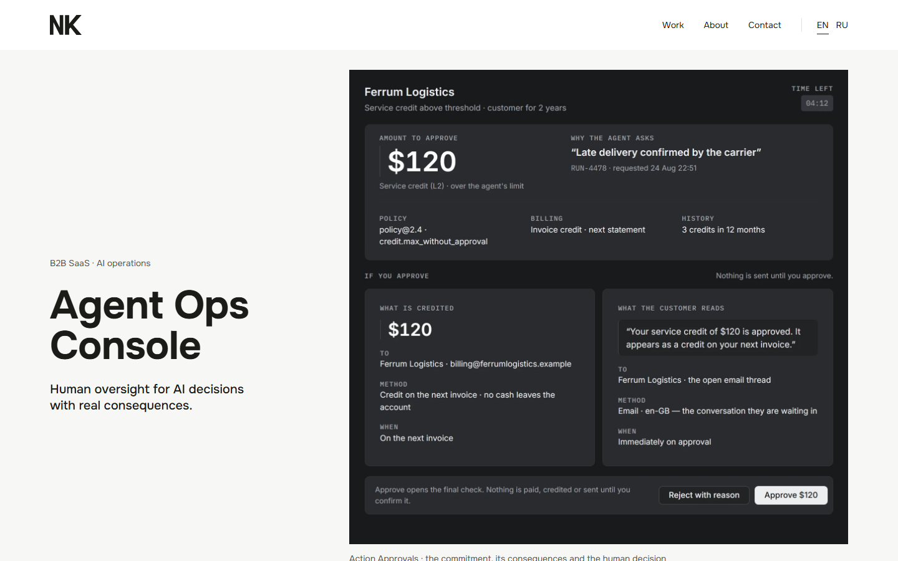
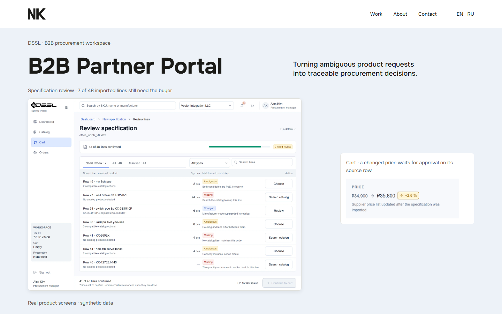
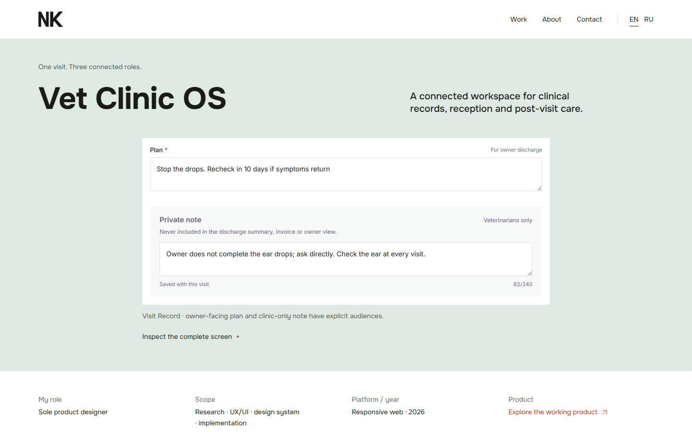
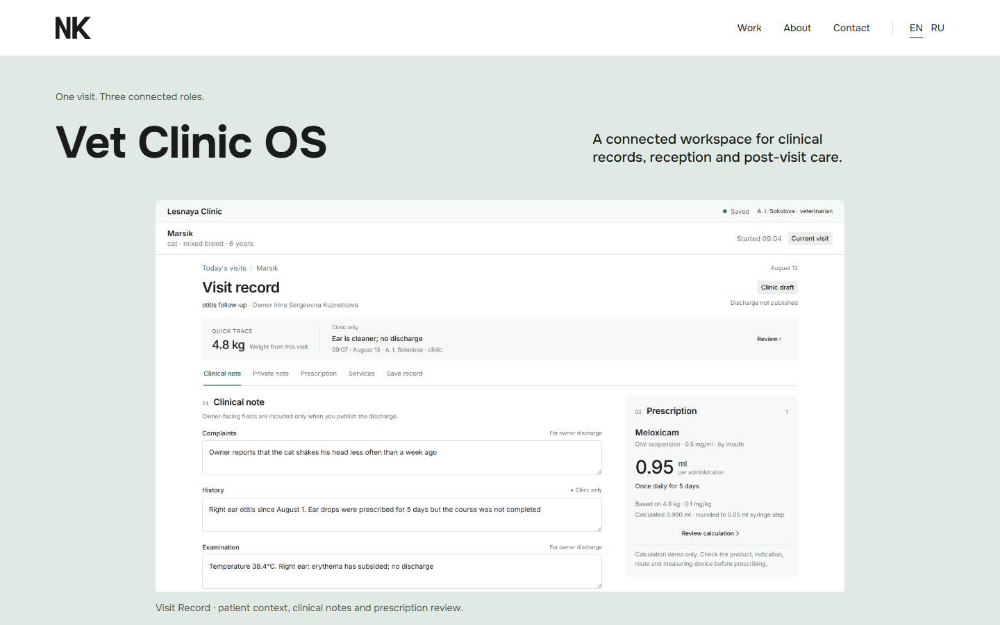

# Vet Clinic OS Portfolio V2.2 — Desktop Hero Only

1 November 2026 · review branch `redesign/vet-portfolio-case-v2` · base `3e82e8acad9b40e2c2bf6aafbb7ad0586d82f2b4`.

**Implemented; independent visual acceptance pending.** Only the desktop case hero presentation and its localized image description/caption changed. The accepted V2.1 outcome typography, inspection action styling, mobile composition, body sections and product claims are preserved.

## Does the new Hero finally match the accepted premium case benchmark?

The new hero addresses the remaining visual gap: it immediately identifies a veterinary workspace and shows a clinical workflow, rather than two isolated form fields. Its clinic/patient bars, Visit Record title, draft/publication status, saved 4.8 kg Quick Trace, section navigation and full prescription panel make the product recognizable. The clinical record sits beside the 0.95 ml prescription, its source weight, rounding, review action and complete limitation text. Private Note evidence is no longer duplicated from Critical States.

Compared with Agent Ops, it now offers a recognizable workspace and a visible consequential decision; compared with Partner Portal, it combines product context with a specific workflow and status. The main Visit Record title, 4.8 kg trace and 0.95 ml result establish the hierarchy at first-viewport scale. Supporting UI labels are smaller than the editorial text, as in the Portal reference; the crop and full original can both be opened at native resolution. There is no decorative frame, collage, floating card or invented UI.

**Implementation assessment:** the context, hierarchy and product-credibility gap identified in V2.1 is addressed, and the result is ready for direct benchmark comparison. Premium parity remains an independent visual decision; it is not self-accepted or inferred from passing tests. Use the matched images below and the [side-by-side comparison gallery](comparison.html).

| Accepted Agent Ops · 1440 | Accepted Partner Portal · 1440 |
|---|---|
|  |  |

| V2.1 · before · EN 1440 | V2.2 · after · EN 1440 |
|---|---|
|  |  |

Direct native-size views: [Agent Ops](../references/agent-ops-console-1440-viewport.png), [Partner Portal](../references/partner-portal-1440-viewport.png), [V2.1 supplied reference](../v2.1/after/en-1440-viewport.png), [V2.2 EN 1440](after/en-1440-viewport.png), [V2.2 RU 1280](after/ru-1280-viewport.png).

## Matched browser captures

Chromium 151.0.7922.34; 900px viewport height; DPR 1; Europe/Moscow; reduced motion. Before: production build of the exact clean base commit, served at 5376. After: final production build, served at 5378. Fonts/images decoded; real scroll/reveal lifecycle exercised. No screenshot CSS or UI substitution.

| Locale / width | First viewport | Complete hero section | Full page |
|---|---|---|---|
| EN 1440 | [before](before/en-1440-viewport.png) / [after](after/en-1440-viewport.png) | [before](before/en-1440-hero.png) / [after](after/en-1440-hero.png) | [before](before/en-1440-full.png) / [after](after/en-1440-full.png) |
| EN 1280 | [before](before/en-1280-viewport.png) / [after](after/en-1280-viewport.png) | [before](before/en-1280-hero.png) / [after](after/en-1280-hero.png) | [before](before/en-1280-full.png) / [after](after/en-1280-full.png) |
| EN 390 | [before](before/en-390-viewport.png) / [after](after/en-390-viewport.png) | [before](before/en-390-hero.png) / [after](after/en-390-hero.png) | [before](before/en-390-full.png) / [after](after/en-390-full.png) |
| EN 360 | [before](before/en-360-viewport.png) / [after](after/en-360-viewport.png) | [before](before/en-360-hero.png) / [after](after/en-360-hero.png) | [before](before/en-360-full.png) / [after](after/en-360-full.png) |
| RU 1440 | [before](before/ru-1440-viewport.png) / [after](after/ru-1440-viewport.png) | [before](before/ru-1440-hero.png) / [after](after/ru-1440-hero.png) | [before](before/ru-1440-full.png) / [after](after/ru-1440-full.png) |
| RU 1280 | [before](before/ru-1280-viewport.png) / [after](after/ru-1280-viewport.png) | [before](before/ru-1280-hero.png) / [after](after/ru-1280-hero.png) | [before](before/ru-1280-full.png) / [after](after/ru-1280-full.png) |
| RU 390 | [before](before/ru-390-viewport.png) / [after](after/ru-390-viewport.png) | [before](before/ru-390-hero.png) / [after](after/ru-390-hero.png) | [before](before/ru-390-full.png) / [after](after/ru-390-full.png) |
| RU 360 | [before](before/ru-360-viewport.png) / [after](after/ru-360-viewport.png) | [before](before/ru-360-hero.png) / [after](after/ru-360-hero.png) | [before](before/ru-360-full.png) / [after](after/ru-360-full.png) |

## Crop and display geometry

One contiguous top rectangle is extracted from each existing full Visit Record PNG. No product pixels are moved, redrawn, erased or resampled in the assets. The lower edge follows the completed Examination field / prescription panel, before the next visible Diagnosis/Services headings. EN is 2812×1600 pixels; RU is 2812×1628 because its prescription warning wraps longer. Both retain the full warning and review control. Private Note remains below the selected rectangle.

The desktop-only display ceiling is 992 CSS px, using existing `measure-lead + space-48` tokens. Natural image height is retained; there is no CSS clipping or fixed-ratio container. The full crop fits the 900px initial viewport in all four desktop configurations. This is roughly the upper 57% of the original 1401/1420 CSS-px-tall records, rather than a return to the full-height V2 cover.

| Configuration | Rendered crop | Top → bottom in first viewport |
|---|---|---|
| en-1440 | 992 × 564.44 CSS px | 287.66 → 852.09 px |
| en-1280 | 992 × 564.44 CSS px | 287.66 → 852.09 px |
| ru-1440 | 992 × 574.31 CSS px | 287.66 → 861.97 px |
| ru-1280 | 992 × 574.31 CSS px | 300.39 → 874.70 px |

[Exact source pixel equality and crop coordinates](hero-provenance.json) · [EN crop](../../../public/media/case-vet-v2/en/visit-workspace-desktop.webp) · [RU crop](../../../public/media/case-vet-v2/ru/visit-workspace-desktop.webp) · [complete media manifest](../MEDIA_MANIFEST.md).

## Zoom and keyboard evidence

Both the hero image and the separate complete-screen action are exercised with pointer and Enter. The first opens the genuine crop; the second opens the unchanged full original. Escape, dialog focus containment, focus restoration and the visible focus ring pass. Native full-image hrefs remain available without JavaScript. The shared zoom implementation is unchanged.

| Configuration | Actual crop zoom | Complete original zoom / end | Inspection focus |
|---|---|---|---|
| en-1440 | [open](after/en-1440-zoom-0.png) | [top](after/en-1440-zoom-1.png) / [end](after/en-1440-complete-record-end.png) | [focus](after/en-1440-inspection-focus.png) |
| en-1280 | [open](after/en-1280-zoom-0.png) | [top](after/en-1280-zoom-1.png) / [end](after/en-1280-complete-record-end.png) | [focus](after/en-1280-inspection-focus.png) |
| en-390 | [open](after/en-390-zoom-0.png) | [top](after/en-390-zoom-1.png) / [end](after/en-390-complete-record-end.png) | [focus](after/en-390-inspection-focus.png) |
| en-360 | [open](after/en-360-zoom-0.png) | [top](after/en-360-zoom-1.png) / [end](after/en-360-complete-record-end.png) | [focus](after/en-360-inspection-focus.png) |
| ru-1440 | [open](after/ru-1440-zoom-0.png) | [top](after/ru-1440-zoom-1.png) / [end](after/ru-1440-complete-record-end.png) | [focus](after/ru-1440-inspection-focus.png) |
| ru-1280 | [open](after/ru-1280-zoom-0.png) | [top](after/ru-1280-zoom-1.png) / [end](after/ru-1280-complete-record-end.png) | [focus](after/ru-1280-inspection-focus.png) |
| ru-390 | [open](after/ru-390-zoom-0.png) | [top](after/ru-390-zoom-1.png) / [end](after/ru-390-complete-record-end.png) | [focus](after/ru-390-inspection-focus.png) |
| ru-360 | [open](after/ru-360-zoom-0.png) | [top](after/ru-360-zoom-1.png) / [end](after/ru-360-complete-record-end.png) | [focus](after/ru-360-inspection-focus.png) |

## Checks and preservation

| Check | Result |
|---|---|
| `npm run check` | PASS · 0 errors, 0 warnings; 163 existing hints. [log](check.txt) |
| `npm run build` | PASS · 37 pages. [log](build.txt) |
| `npm run check:content` | PASS. [log](check-content.txt) |
| `npm run check:css` | PASS. [log](check-css.txt) |
| `npm run check:harmony` | PASS. [log](check-harmony.txt) |
| Targeted harmony | PASS · both locales at 1440/1280/768/390/360. [log](harmony-vet.txt) |
| Targeted browser QA | PASS · 180/180 assertions across eight configurations. Zero overflow, split heading words, runtime errors, failed assets or scoped hero axe A/AA findings. [log](browser-after.txt), [results](after/results.json) |
| Mobile regressions | All four 390/360 EN/RU viewport, complete hero and full-page pairs are pixel-identical to the base. Body/outcome/states captures also match exactly on mobile. [results](after/results.json) |
| Body preservation | Content, relative geometry, image sources and links are unchanged in all eight configurations. Desktop body raster hashes differ because the taller hero changes the fractional vertical origin; no body CSS, copy or media changed. [before](before/results.json), [after](after/results.json) |
| Home | 4/4 full-page EN/RU × 1440/390 pairs are pixel-identical. [evidence](preservation.json) |
| Original media and claims | All 54 existing manifest entries and file hashes preserved. Only two exact-source crops added. Body copy, original/mobile hero copy, VetShot, VetHome and token files match the base. [preservation](preservation.json), [log](preservation.txt) |

The initial strict desktop body screenshot-hash assertion failed and is retained in [initial results](iterations/initial-after-results.json) / [log](iterations/initial-browser-after.txt). The final harness compares every body section, heading, paragraph, image and link relative to the body origin (under 0.05 CSS px tolerance) and its exact content/source, while retaining strict mobile screenshot equality. No product code or screenshot pixels were changed to resolve that harness assumption.

No feature claims, values, publication states or synthetic-data provenance changed. Clinical 0.95 ml and invoice 1,500 RUB evidence remain original. Outcome wrapping and secondary inspection styles are unchanged. No neighbouring case source, shared component, global token, merge, production deployment or Figma change.

## Reproduce

Use a clean worktree at the base SHA for the before build, and serve it on 5376. Build the review branch and serve it on 5378. Run `qa.mjs before` with `BASE_URL=http://127.0.0.1:5376`, then `qa.mjs after` with 5378. Run `preservation.mjs`, the five repository checks and the targeted harmony command recorded in its log. Playwright/axe use the existing external QA installation; no dependency was added. `frame-hero.mjs` regenerates the two lossless derivatives, followed by the existing media-manifest builder. `write-report.mjs` regenerates this report and gallery.

Verification scope: Chromium at the requested dimensions, plus tablet harmony. Physical-device, Safari/Firefox and spoken screen-reader testing were not performed. Independent premium/benchmark acceptance remains pending.
